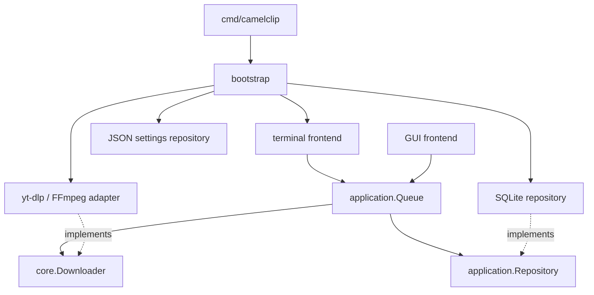

# Architecture and extension contracts

CamelClip separates policy, process execution, persistence and presentation. The entry points in `cmd/camelclip` and `cmd/camelclip-gui` are composition roots: they construct adapters in `internal/bootstrap` and inject typed ports into their frontends. Constructors are the only place that know the concrete implementation of every module.



## Engine: core.Downloader

The engine exposes `Inspect(ctx, Request)`, `Download(ctx, Request, Observer)` and `Formats(ctx, Request, Observer)`. `Request` contains only download/output parameters, not language, keyboard, terminal, database, or application configuration objects. `Download` returns a typed `Result` with the published path. Observers receive typed stage, progress, log and publication events.

The concrete `ytdlp.Engine` launches subprocesses without a shell, isolates staging areas, inherits staging locks into children, converts the selected profile, validates media, and publishes without overwriting. It writes neither stdout nor stderr of the parent process and reads no settings or queue database. Observer calls are serialized per download; multiple downloads may run concurrently. Cancellation uses `context.Context` and terminates the process group. The observer must return promptly.

## Application: application.Queue

Frontends submit requests, select quality, cancel, retry, remove terminal history, start execution, read job snapshots, and consume events. The service owns worker slots, all authoritative job state, shutdown behavior and persistence. `Jobs()` and events return copies, including media-format slices. UI code never mutates application jobs.

The service depends only on `core.Downloader` and `application.Repository`. It can run headlessly with an alternative engine or in-memory repository, as demonstrated by its contract tests. It persists requests before scheduling network work, preserves interrupted phases for restart, and stops scheduling if persistence fails. `StartOnly(ids)` is used by explicit CLI commands so unrelated pending jobs do not start inadvertently.

The event channel is a bounded, single-consumer notification stream. Slow observers may miss progress notifications; `Jobs()` is the authoritative snapshot. Frontends must resynchronize after events and periodically while running. `Close()` cancels/reaps workers, persists resumable state and closes storage. Each service has one frontend consumer; a GUI supporting multiple views should fan out snapshots/events in its own presentation layer.

## Internal responsibility boundaries

`CloudService` coordinates upload admission, cancellation, vault locking and shutdown. Its private `profileManager` owns credential encryption, vault initialization/rotation and atomic profile persistence; it never schedules work. Every manager call is protected by the service mutex, and vault locking still cancels and joins active network operations before removing keys. Upload source identity checks and cancellable hashing live in `upload_source.go`.

The download queue delegates its adapter boundary to `downloadWithContract`: callback serialization, stage/metric/result validation and rejection of callbacks after return or panic. Queue state transitions, resource admission and persistence remain in the queue service. These components preserve the public service methods and storage schema.

`core.QueuePolicy.Validate` and `core.UploadOptions.Validate` define queue and S3 resource constraints. Settings and all local frontends reuse those rules through `Settings.QueuePolicy()` and `Settings.UploadOptions()`. Persisted zero upload concurrency resolves through `UploadOptions.WithDefaults`; runtime service setters continue to require explicit positive concurrency. `application.QueuePolicy` remains a type alias for source compatibility. Validation at service/storage trust boundaries remains intentional.

## Persistence

`application.Repository` atomically loads/saves a typed snapshot. The SQLite implementation owns schema versioning, locking, transactions and WAL settings. Jobs have their own rows with indexed primary IDs, URL, status, title, output path, quality-selection flag, and JSON-encoded per-job request/metadata values. Only changed rows are updated and removed IDs are deleted transactionally. Database and queue-lock files use owner-only creation permissions.


`config.Repository` is a separate port for user preferences. Its JSON file adapter atomically writes `settings.json`. A job captures a copy of download parameters; changing preferences does not mutate queued work. Retrying an authentication failure explicitly takes the current browser selector.

## GUI frontend

The implemented frontend lives in `internal/ui/gui`, with its composition root in `cmd/camelclip-gui`. Embedded HTML/CSS/JavaScript is served on a random loopback port behind a per-session token, Host and Origin checks. The macOS AppKit/WebKit host is in `scripts/gui/Window.swift`; Linux and explicit browser mode use the default browser. It opens `bootstrap.OpenWorkspace`, so the same repository lock excludes simultaneous TUI/GUI instances. No IPC or background daemon is introduced. See [GUI documentation](gui.md).

## Extending the GUI

Add another executable under `cmd/` and a frontend under `internal/ui/`. Wire the same ports through `bootstrap`, or provide alternative implementations. A GUI can use the service without importing terminal code or invoking subprocesses itself:

```go
backend := bootstrap.Downloader()
queue, err := bootstrap.OpenQueue(backend)(ctx, configPath, 2)
if err != nil { /* show startup error */ }
defer queue.Close()
queue.Start()
// queue.Submit(request, true), queue.Choose(id, quality), queue.Cancel(id), ...
// Consume queue.Events(), then read queue.Jobs() and marshal updates to the UI thread.
```

These are internal module APIs intended for frontends in this repository. They do not promise a versioned external SDK or an HTTP protocol. `core` and `application` have no concrete UI/storage dependencies; dependency-direction tests reject accidental coupling. Backend media tests, SQLite transaction/fault tests and UI navigation tests are kept alongside their packages.


## Operating-system integration and diagnostics

The terminal frontend selects `platform_darwin.go` or `platform_linux.go` at build time. They own desktop opening, preferred-language fallback, dependency hints and default Downloads locations. Linux reads XDG user-directory data without executing it. Shared Unix process-group cancellation and flock-based queue/staging locks are used on both supported systems. Windows needs additional implementations before it can be built.

`diagnostics` is independent of the frontend and produces a typed offline report. It probes tools, selected encoders, storage and read-only SQLite integrity, retaining only safe metadata. It never uses a downloader or browser cookies. The terminal renders this report as text or JSON; the GUI uses it directly.

## Resource scheduling and monitoring

Network fetching and CPU work have independent permits ordered by job priority and position. Metadata inspection is separately bounded to five tasks. Download permits are released after yt-dlp exits, before a job waits for processing. FFmpeg merging, extraction, conversion and full decode verification share the processing permit. Automatic processing concurrency is max(integer CPU count / 4, 2); download concurrency defaults to five. Lowering limits never interrupts existing children.

A configured global rate budget is divided by maximum download concurrency and passed to each new yt-dlp process, combined with the per-job cap using the smaller nonzero value. This intentionally leaves bandwidth unused when fewer jobs run. Changes affect new processes; running children retain their original limits. This is a conservative allocation policy, not an instantaneous traffic shaper. CLI overrides are transient. Rates use bytes/second, optionally KiB/s or MiB/s, with zero meaning unlimited.

Numerical yt-dlp and FFmpeg progress feeds per-stage in-memory metrics. Unknown totals, speed and ETA remain absent; speed uses a bounded three-second window and expires after three seconds without updates. High-frequency samples do not write SQLite. State transitions persist monitoring timestamps and diagnostics. Schema 2 migrates schema 1 transactionally without deleting history.

The dashboard refreshes authoritative snapshots at four hertz, retains selection by job ID and clips every cell to terminal width. macOS and Linux share the same scheduler and canvas; platform adapters continue to own terminal handling, process cancellation and desktop opening.

## Workspace services

`application.Workspace` composes Queue, LibraryService, CloudService and SystemMonitor over small typed repository and engine ports. Bootstrap shares one locked SQLite repository; shutdown stops cloud, scans and metrics before the queue closes storage. The downloader still imports only core and never imports S3, a UI or the database.

Queue controls are stored separately from transient metrics. Resource permits carry stable job IDs and are ordered before worker goroutines start. Priority and position changes also reorder existing waiters. Disk capacity blocks already waiting download permits; processing/verification and S3 retain independent limits.

Published files, durable source snapshots, publication outbox entries and any enabled automatic S3 jobs are written in the queue transaction. Assets survive history removal. Library queries paginate in SQLite and normalize Unicode search text. S3 profiles/sealed secrets and multipart cleanup IDs remain in SQLite. Security uses a CredentialVault port; S3 uses a Uploader port with numerical progress and no shell invocation.

## Installation and distribution

`cmd/camelclip-setup` uses the UI-independent `internal/installer` package. It installs prebuilt component payloads, tracks file ownership, verifies hashes, preserves installed selections on upgrade and rolls back ordinary write failures. Installer messages are English-only; application localization stays in the application frontends.

Packaging and native macOS choices are generated by `scripts/package_setup.py`. Shared terminal files have one owner even when both TUI and CLI are selected. Generated output is separated into intermediate `dist/build/`, versioned `dist/installers/<version>/`, and legacy `dist/terminal/` artifacts. See [installation](installers.md) and [release workflow](releases.md).

A future server needs its own executable, state directory and explicit service lifecycle. It must not bypass the local workspace lock or share a live local database. No server component or network listener is installed by setup today.

## Publication identity and retry attempts

Publication collisions require content identity, not just matching duration and codecs. A different existing file produces a conflict and preserves staged output. The publication ledger identifies each job/path pair, so a later attempt producing a different path is indexed independently; schema 4 preserves schema 3 publication history.

Monitoring separates execution identity/count from the automatic retry budget. Explicit retry clears current output, metadata, timing and diagnostics, resets automatic retries, and retains cumulative execution history. Published assets survive attempt resets.

## Service lifetime and cloud cleanup

Library and cloud operations have serialized admission, a cancellation context and a join barrier. Shutdown rejects new calls and joins admitted calls before releasing shared storage. Enrichment startup is idempotent. Queue limit/policy mutations reject a closed service. Cloud fatal failures are exposed by Err, reads used by wait loops, and Close; Workspace.Close joins component errors.

Explicit multipart cleanup reserves its job against scheduling and retry, performs remote work outside the service mutex, then merges only the matching multipart checkpoint into the current record. A concurrent cancellation is preserved. Vault locking cancels and joins tracked credential-bearing network tests and cleanup operations as well as upload workers.

## Validated adapter and command contracts

Downloader and uploader callbacks are serialized and must finish before their operation returns. Queue validates media metadata, stage ordering, finite metrics, absolute result paths and publication/result agreement before accepting adapter output. Cloud validates upload metrics and successful verification results; adapter panics become item failures. Invalid adapter output does not poison shared persistence.

Core.Failure carries a stable code, cause and retryability; application retry policy does not parse diagnostic text. Text classification of yt-dlp failures belongs to the yt-dlp adapter. UploadState owns valid, terminal and needs-attention categories. Existing JSON state values remain unchanged.

RetryWithOptions and BulkActionWithOptions distinguish preserving browser authentication (nil), replacing it, and clearing it (pointer to an empty string). Legacy Retry remains compatible. Frontends share the bulk implementation and current-browser policy. Config owns defaults and canonical normalization, including zero resource defaults and absolute output paths. Bootstrap.OpenQueue honors the requested metadata worker count.

## Incremental queue persistence

SQLite implements the optional IncrementalRepository port. Queue saves contain only dirty jobs and explicit removals; unmentioned history is retained. Changed jobs, publication reconciliation, source records and automatic uploads still commit in one transaction. Restored state is flushed once, and shutdown flushes resumable active state. Repositories implementing only Save(Snapshot) remain supported. Persistence calls receive a ten-second context deadline and errors stop scheduling.

Queue uses an ID index and exposes JobsPage(offset, limit), capped at 200 immutable jobs per read, alongside the compatible Jobs snapshot API.

A local macOS arm64 benchmark with 1,000 stored jobs and one modified row (10 iterations) measured approximately 39.4 ms / 4.49 MB allocated per full snapshot versus 0.236 ms / 5.23 KB per incremental transaction. This measures persistence overhead on one machine, not an end-to-end throughput guarantee. Run `go test ./internal/storage/sqlite -run '^$' -bench 'BenchmarkQueue(Snapshot|Incremental)1000' -benchtime=10x` to reproduce.
