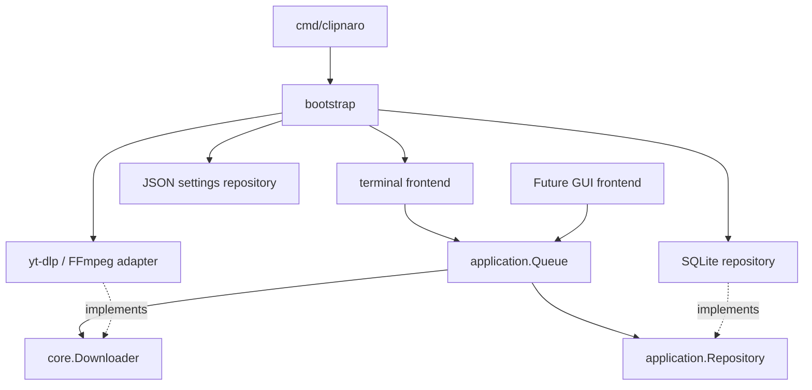

# Architecture and extension contracts

Clipnaro separates policy, process execution, persistence and presentation. The binary in `cmd/clipnaro` is the composition root: it constructs adapters in `internal/bootstrap` and injects typed ports into the terminal frontend. Constructors are the only place that know the concrete implementation of every module.



## Engine: core.Downloader

The engine exposes `Inspect(ctx, Request)`, `Download(ctx, Request, Observer)` and `Formats(ctx, Request, Observer)`. `Request` contains only download/output parameters, not language, keyboard, terminal, database, or application configuration objects. `Download` returns a typed `Result` with the published path. Observers receive typed stage, progress, log and publication events.

The concrete `ytdlp.Engine` launches subprocesses without a shell, isolates staging areas, inherits staging locks into children, converts the selected profile, validates media, and publishes without overwriting. It writes neither stdout nor stderr of the parent process and reads no settings or queue database. Observer calls are serialized per download; multiple downloads may run concurrently. Cancellation uses `context.Context` and terminates the process group. The observer must return promptly.

## Application: application.Queue

Frontends submit requests, select quality, cancel, retry, remove terminal history, start execution, read job snapshots, and consume events. The service owns worker slots, all authoritative job state, shutdown behavior and persistence. `Jobs()` and events return copies, including media-format slices. UI code never mutates application jobs.

The service depends only on `core.Downloader` and `application.Repository`. It can run headlessly with an alternative engine or in-memory repository, as demonstrated by its contract tests. It persists requests before scheduling network work, preserves interrupted phases for restart, and stops scheduling if persistence fails. `StartOnly(ids)` is used by explicit CLI commands so unrelated pending jobs do not start inadvertently.

The event channel is a bounded, single-consumer notification stream. Slow observers may miss progress notifications; `Jobs()` is the authoritative snapshot. Frontends must resynchronize after events and periodically while running. `Close()` cancels/reaps workers, persists resumable state and closes storage. Each service has one frontend consumer; a GUI supporting multiple views should fan out snapshots/events in its own presentation layer.

## Persistence

`application.Repository` atomically loads/saves a typed snapshot. The SQLite implementation owns schema versioning, locking, transactions and WAL settings. Jobs have their own rows with indexed primary IDs, URL, status, title, output path, quality-selection flag, and JSON-encoded per-job request/metadata values. Only changed rows are updated and removed IDs are deleted transactionally. Database and queue-lock files use owner-only creation permissions.


`config.Repository` is a separate port for user preferences. Its JSON file adapter atomically writes `settings.json`. A job captures a copy of download parameters; changing preferences does not mutate queued work. Retrying an authentication failure explicitly takes the current browser selector.

## Adding a GUI

Add another executable under `cmd/` and a frontend under `internal/ui/`. Wire the same ports through `bootstrap`, or provide alternative implementations. A GUI can use the service without importing terminal code or invoking subprocesses itself:

```go
backend := bootstrap.Downloader()
queue, err := bootstrap.OpenQueue(backend)(ctx, configPath, 2)
if err != nil { /* show startup error */ }
defer queue.Close()
queue.Start()
// queue.Submit(request, true), queue.Choose(id, quality), queue.Cancel(id), ...
// Consume queue.Events(), then read queue.Jobs() and marshal updates to the UI thread.
```

These are internal module APIs intended for frontends in this repository. They do not promise a versioned external SDK or an HTTP protocol. `core` and `application` have no concrete UI/storage dependencies; dependency-direction tests reject accidental coupling. Backend media tests, SQLite transaction/fault tests and UI navigation tests are kept alongside their packages.


## Operating-system integration and diagnostics

The terminal frontend selects `platform_darwin.go` or `platform_linux.go` at build time. They own desktop opening, preferred-language fallback, dependency hints and default Downloads locations. Linux reads XDG user-directory data without executing it. Shared Unix process-group cancellation and flock-based queue/staging locks are used on both supported systems. Windows needs additional implementations before it can be built.

`diagnostics` is independent of the frontend and produces a typed offline report. It probes tools, selected encoders, storage and read-only SQLite integrity, retaining only safe metadata. It never uses a downloader or browser cookies. The terminal renders this report as text or JSON; a future GUI can use it directly.

## Resource scheduling and monitoring

Network fetching and CPU work have independent FIFO permits. Metadata inspection is separately bounded to five tasks. Download permits are released after yt-dlp exits, before a job waits for processing. FFmpeg merging, extraction, conversion and full decode verification share the processing permit. Automatic processing concurrency is max(integer CPU count / 4, 2); download concurrency defaults to five. Lowering limits never interrupts existing children.

A configured global rate budget is divided by maximum download concurrency and passed to each new yt-dlp process, combined with the per-job cap using the smaller nonzero value. This intentionally leaves bandwidth unused when fewer jobs run. Changes affect new processes; running children retain their original limits. This is a conservative allocation policy, not an instantaneous traffic shaper. CLI overrides are transient. Rates use bytes/second, optionally KiB/s or MiB/s, with zero meaning unlimited.

Numerical yt-dlp and FFmpeg progress feeds per-stage in-memory metrics. Unknown totals, speed and ETA remain absent; speed uses a bounded three-second window and expires after three seconds without updates. High-frequency samples do not write SQLite. State transitions persist monitoring timestamps and diagnostics. Schema 2 migrates schema 1 transactionally without deleting history.

The dashboard refreshes authoritative snapshots at four hertz, retains selection by job ID and clips every cell to terminal width. macOS and Linux share the same scheduler and canvas; platform adapters continue to own terminal handling, process cancellation and desktop opening.
